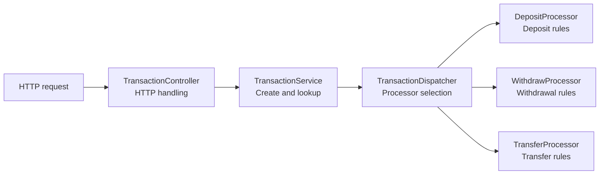
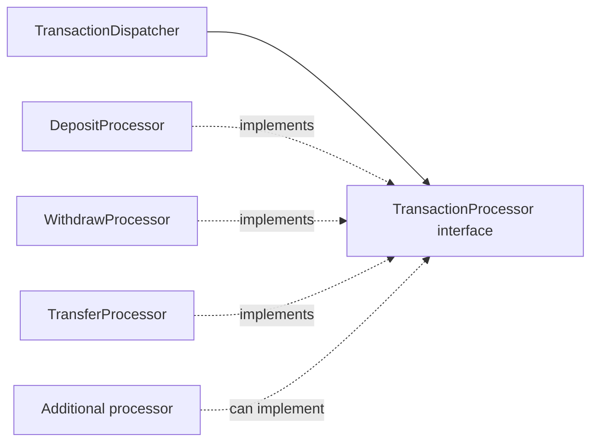
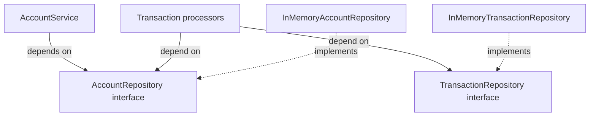
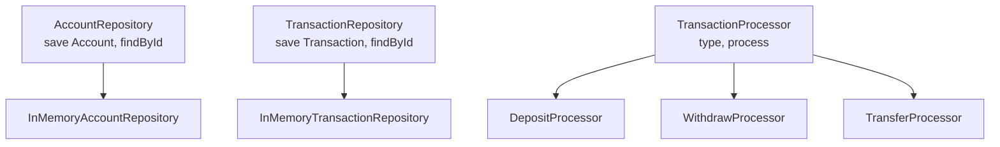

# SOLID principles in the banking transaction project

This Spring Boot project exposes account and transaction endpoints. Its transaction flow uses a dispatcher to select a processor for deposits, withdrawals, or transfers, while repository interfaces provide access to stored accounts and transactions.

## 1. Single Responsibility Principle

Each component has a focused job. [`TransactionController`](../src/main/java/com/example/tmps_lab/controller/TransactionController.java) handles HTTP requests, [`TransactionService`](../src/main/java/com/example/tmps_lab/service/TransactionService.java) coordinates transaction creation and lookup, and [`TransactionDispatcher`](../src/main/java/com/example/tmps_lab/service/TransactionDispatcher.java) selects the appropriate processor. The individual [`DepositProcessor`](../src/main/java/com/example/tmps_lab/service/processor/DepositProcessor.java), [`WithdrawProcessor`](../src/main/java/com/example/tmps_lab/service/processor/WithdrawProcessor.java), and [`TransferProcessor`](../src/main/java/com/example/tmps_lab/service/processor/TransferProcessor.java) classes each implement the rules for one transaction type. This separation keeps HTTP handling, dispatch, and transaction rules in distinct places.

## 2. Open/Closed Principle

[`TransactionProcessor`](../src/main/java/com/example/tmps_lab/service/processor/TransactionProcessor.java) defines a common `type()` and `process()` contract. `TransactionDispatcher` receives a list of processor implementations and builds a lookup map from their transaction types. A new processor can therefore be added without changing the dispatcher's selection logic. The extension still requires a new value in [`TransactionType`](../src/main/java/com/example/tmps_lab/model/TransactionType.java), so the transaction model is not fully closed to modification.

## 3. Dependency Inversion Principle

Business components depend on repository abstractions instead of storage classes. For example, [`AccountService`](../src/main/java/com/example/tmps_lab/service/AccountService.java) takes an [`AccountRepository`](../src/main/java/com/example/tmps_lab/repository/AccountRepository.java) in its constructor, and the processors take `AccountRepository` and [`TransactionRepository`](../src/main/java/com/example/tmps_lab/repository/TransactionRepository.java). The current implementations, [`InMemoryAccountRepository`](../src/main/java/com/example/tmps_lab/repository/InMemoryAccountRepository.java) and [`InMemoryTransactionRepository`](../src/main/java/com/example/tmps_lab/repository/InMemoryTransactionRepository.java), supply storage behavior. This lets the business logic use another repository implementation without depending on its concrete class.

## 4. Interface Segregation Principle

The project also implements interface segregation through small, purpose-specific contracts. `AccountRepository` exposes only account `save` and `findById` operations; `TransactionRepository` exposes the equivalent transaction operations; and `TransactionProcessor` contains only the two methods needed to identify and run a processor. A class implementing one of these interfaces does not have to provide unrelated account, transaction, or HTTP methods.

