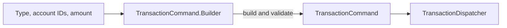
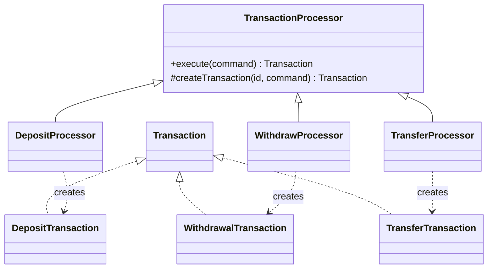

# Lab 2: Creational design patterns in the banking transaction project

## Objective

Extend the banking application with three creational patterns: Builder, Prototype, and Factory Method. The application supports deposits, withdrawals, and transfers. Each pattern addresses a different part of transaction creation: preparing a valid command, reusing an existing transaction's instructions, and constructing the correct transaction product.

## 1. Builder

The [`TransactionCommand`](../src/main/java/com/example/tmps_lab/dto/TransactionCommand.java) record has four fields: transaction type, source account ID, destination account ID, and amount. Different transaction types need different combinations of account IDs. Its nested `Builder` lets application code set these fields one at a time and validates the completed command in `build()`.

```java
TransactionCommand command = TransactionCommand.builder()
    .type(TransactionType.TRANSFER)
    .fromAccountId(sourceId)
    .toAccountId(destinationId)
    .amount(50)
    .build();
```

The builder requires a type and positive amount. It also requires a destination for a deposit, a source for a withdrawal, and both distinct accounts for a transfer. [`TransactionTemplate.toCommand()`](../src/main/java/com/example/tmps_lab/model/TransactionTemplate.java) uses this builder when preparing a repeated transaction. HTTP requests are deserialized directly into `TransactionCommand`, so the processors also validate commands before changing balances.



## 2. Prototype

[`TransactionTemplate`](../src/main/java/com/example/tmps_lab/model/TransactionTemplate.java) is the prototype. It contains the type, account IDs, and amount, but no transaction ID. `copy()` produces another template with the same instructions; `copyWithAmount()` produces a variant with a new amount while leaving the original unchanged.

The [`TransactionService.repeat()`](../src/main/java/com/example/tmps_lab/service/TransactionService.java) operation reads a saved transaction, creates a template from it, copies the template with the requested amount, builds a command, and processes that command. Processing generates a new transaction ID and applies the account balance change again. The caller can invoke this through [`POST /transactions/{id}/repeat`](../src/main/java/com/example/tmps_lab/controller/TransactionController.java) with a JSON body such as `{"amount": 50}`.


The prototype copies instructions, rather than an already completed financial transaction. This allows the normal validation and balance rules to run for every repeat.

## 3. Factory Method

[`TransactionProcessor`](../src/main/java/com/example/tmps_lab/service/processor/TransactionProcessor.java) defines the protected abstract factory method `createTransaction(UUID, TransactionCommand)`. Its final `execute()` method runs the processor's rules, calls the factory method, and saves the returned product. Each subclass decides which concrete transaction to create:

| Creator | Product |
| --- | --- |
| [`DepositProcessor`](../src/main/java/com/example/tmps_lab/service/processor/DepositProcessor.java) | [`DepositTransaction`](../src/main/java/com/example/tmps_lab/model/DepositTransaction.java) |
| [`WithdrawProcessor`](../src/main/java/com/example/tmps_lab/service/processor/WithdrawProcessor.java) | [`WithdrawalTransaction`](../src/main/java/com/example/tmps_lab/model/WithdrawalTransaction.java) |
| [`TransferProcessor`](../src/main/java/com/example/tmps_lab/service/processor/TransferProcessor.java) | [`TransferTransaction`](../src/main/java/com/example/tmps_lab/model/TransferTransaction.java) |

These products implement the sealed [`Transaction`](../src/main/java/com/example/tmps_lab/model/Transaction.java) interface. [`TransactionDispatcher`](../src/main/java/com/example/tmps_lab/service/TransactionDispatcher.java) selects a processor by type; the selected processor's factory method creates the product. The repository stores products through the common interface, and [`TransactionResponse`](../src/main/java/com/example/tmps_lab/dto/TransactionResponse.java) keeps the HTTP response fields consistent.



## Verification

[`TransactionProcessorTests`](../src/test/java/com/example/tmps_lab/TransactionProcessorTests.java) covers builder validation, the concrete products created by each processor, and repeating a transaction with a changed amount. The repeat test checks that the original template and amount stay unchanged, the new transaction has a different ID, and the account balance reflects both operations. It also checks that a withdrawal response retains its source and type.

The focused tests passed with `./mvnw -o -q test -Dtest=TransactionProcessorTests -Djava.version=21`. The Java version override was needed because this machine has Java 21 while `pom.xml` requests Java 25. Stale Java 25 build output was removed before this run.

## Conclusion

Builder creates validated transaction commands, Prototype reuses transaction instructions without reusing an ID, and Factory Method lets each processor instantiate its matching transaction type. Together they make transaction creation explicit while preserving the shared dispatcher, repository, and HTTP response flow.
