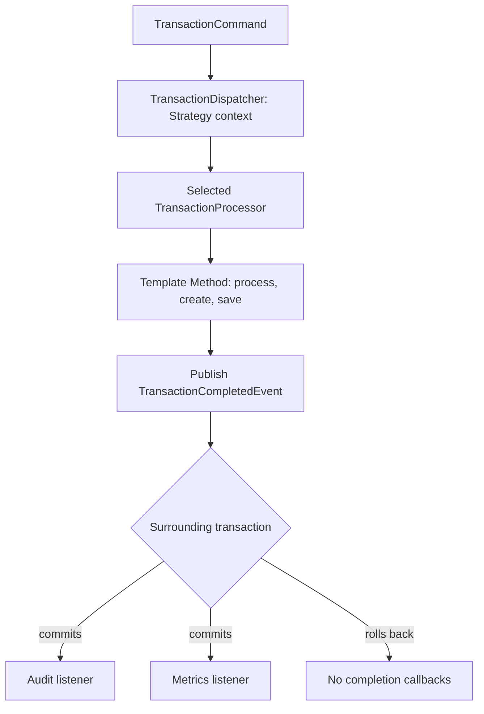

# Lab 3: Behavioral design patterns in the banking transaction project

## Objective

Demonstrate three behavioral patterns in transaction processing: Strategy, Template Method, and Observer. Strategy and Template Method already exist in the processor design; Observer adds independent reactions to committed transactions. No HTTP contracts, database schema, or financial processing rules are changed.

## 1. Strategy

[`TransactionDispatcher`](../src/main/java/com/example/tmps_lab/service/TransactionDispatcher.java) is the context. It receives the available implementations of [`TransactionProcessor`](../src/main/java/com/example/tmps_lab/service/processor/TransactionProcessor.java), indexes them by `TransactionType`, and selects one for each command.

| Role | Implementation |
| --- | --- |
| Context | `TransactionDispatcher` |
| Strategy abstraction | `TransactionProcessor` |
| Concrete strategies | `DepositProcessor`, `WithdrawProcessor`, `TransferProcessor` |

```java
TransactionProcessor processor = processors.get(command.type());
Transaction transaction = processor.execute(command);
```

The dispatcher delegates transaction-specific behavior instead of containing a switch with every operation's implementation. A strategy can use an abstract class; an interface is not required. Adding another operation requires a new processor and transaction type, without adding its financial rules to the dispatcher.

## 2. Template Method

The final `TransactionProcessor.execute()` defines the shared processing algorithm:

```java
public final Transaction execute(TransactionCommand command) {
    process(command);
    Transaction transaction = createTransaction(UUID.randomUUID(), command);
    return transRepo.save(transaction);
}
```

Subclasses implement `process()` and `createTransaction()`. They supply operation-specific rules and products, but cannot reorder or bypass the shared algorithm by overriding `execute()`.

This complements the Factory Method from Lab 2: `execute()` is the Template Method, while `createTransaction()` is the Factory Method called within it. Strategy describes the dispatcher's choice among processors; Template Method describes the internal algorithm shared by those processors.

## 3. Observer

### Motivation and roles

Logging and metrics are reactions to successful transactions, not deposit, withdrawal, or transfer rules. Putting these reactions into each processor would duplicate responsibilities and couple financial processing to its consumers.

The dispatcher now publishes an immutable [`TransactionCompletedEvent`](../src/main/java/com/example/tmps_lab/event/TransactionCompletedEvent.java) after the selected processor has processed and saved the transaction:

```java
Transaction transaction = processor.execute(command);
events.publishEvent(new TransactionCompletedEvent(transaction));
return transaction;
```

Spring's `ApplicationEventPublisher` distributes the event to independently registered observers:

| Observer | Responsibility |
| --- | --- |
| [`TransactionAuditListener`](../src/main/java/com/example/tmps_lab/event/TransactionAuditListener.java) | Log the committed transaction's ID, type, and amount. |
| [`TransactionMetricsListener`](../src/main/java/com/example/tmps_lab/event/TransactionMetricsListener.java) | Increment a thread-safe, process-local completion counter for the transaction type. |

The dispatcher knows the event publisher, not the listeners. Additional observers can be added without changing the dispatcher or processors. The metrics listener exposes `completedCount(TransactionType)` for programmatic inspection; this change does not add a metrics HTTP endpoint.



### Commit semantics

Both observers use:

```java
@TransactionalEventListener(phase = TransactionPhase.AFTER_COMMIT)
public void onTransactionCompleted(TransactionCompletedEvent event) {
    // React to the committed transaction.
}
```

The event is published inside the dispatcher's `@Transactional` method, but the observers wait for the surrounding transaction to commit. If the dispatcher joins an existing transaction, callbacks wait for that outer transaction. A validation error or save failure prevents publication; a subsequent rollback suppresses the callbacks even if publication already happened.

`fallbackExecution` remains disabled. Publishing an event without an active transaction does not invoke these commit observers. Callers should use the Spring-managed dispatcher to obtain its transactional proxy; manually constructing the dispatcher bypasses that transaction management.

### Scope and limitations

- Audit output is operational logging, not a durable or tamper-proof financial audit ledger.
- Counters reset when the application restarts and are not shared across application instances.
- Listeners run synchronously during transaction completion; their ordering is not relied upon, and they do not depend on one another.
- These are in-process events, not Kafka messages. There is no durable delivery, retry, or exactly-once guarantee across crashes. A production external notification system would need a durable approach such as a transactional outbox.
- An after-commit observer cannot undo a committed financial operation. These listeners do not write database state.

## Verification

[`TransactionObserverTests`](../src/test/java/com/example/tmps_lab/TransactionObserverTests.java) uses a small Spring context to exercise actual event registration, transactional proxies, and transaction synchronization without requiring Docker. It verifies:

- Deposits, withdrawals, and transfers publish the saved transaction, notifying both observers once after commit, not before.
- The dispatcher starts a transaction when there is no outer transaction.
- Rolling back an outer transaction suppresses both observers.
- Rejected operations and failed saves publish no completion event.
- Events published outside a transaction do not invoke the commit observers.

Its lightweight transaction manager tests synchronization only: the in-memory repositories themselves do not roll back data. [`PostgresStorageTests`](../src/test/java/com/example/tmps_lab/PostgresStorageTests.java) separately verifies real database rollback: the rolled-back transaction and balance change are absent, the metric is unchanged, and a later committed deposit updates both storage and the completion counter.

The existing [`TransactionProcessorTests`](../src/test/java/com/example/tmps_lab/TransactionProcessorTests.java) continues to cover processor products, account balance changes, Builder validation, and repeated transactions.

Full-suite verification, including PostgreSQL Testcontainers:

```bash
./mvnw -o -q test -Djava.version=21
```

All 16 tests passed with no failures or errors. The Java version override matches the installed Java 21 runtime; `pom.xml` still requests Java 25.

## Conclusion

Strategy selects transaction-specific behavior, Template Method preserves the shared execution sequence, and Observer decouples completion reactions from financial processing. The three patterns solve different problems and work together without introducing extra account states or restructuring validation just to increase the pattern count.
