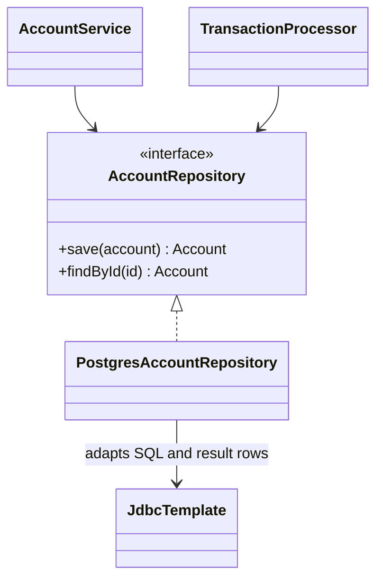
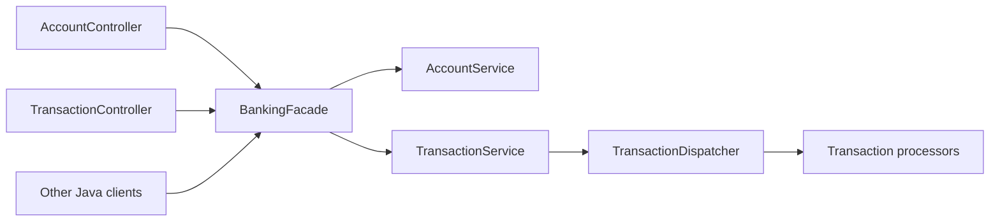
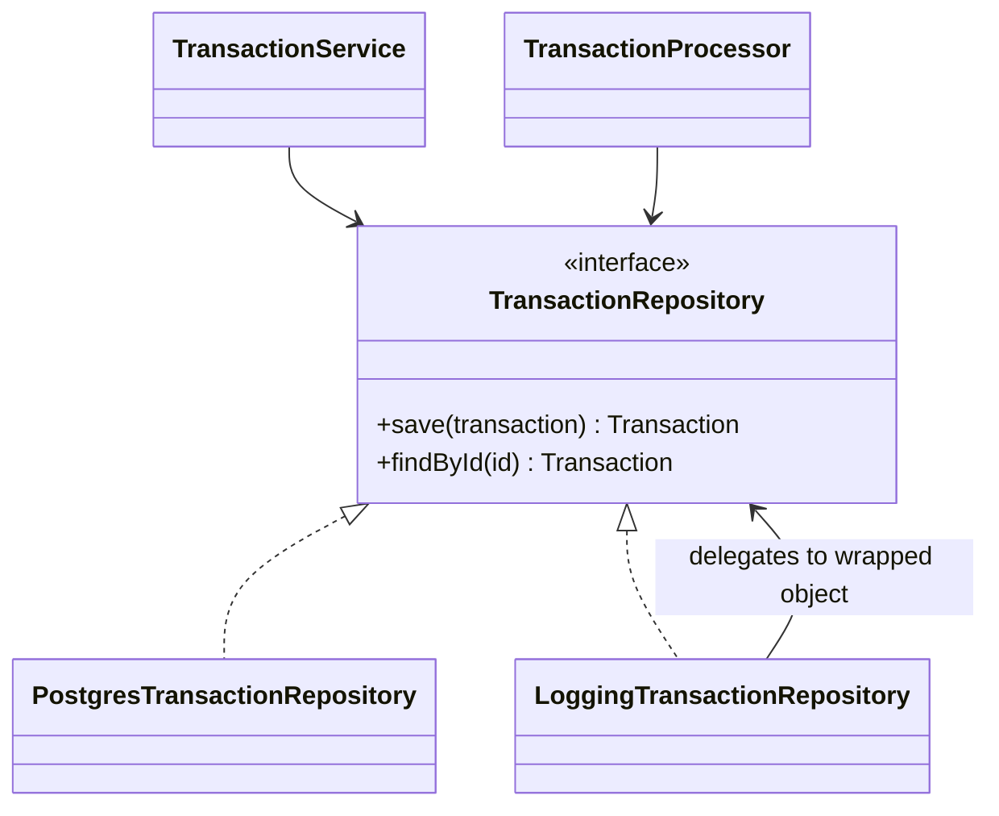

# Lab 4: Structural design patterns in the banking transaction project

## Objective

Demonstrate three structural patterns: Adapter, Facade, and Decorator. Adapter translates the application's account operations into JDBC persistence, Facade provides a single entry point to banking services, and Decorator adds repository logging without changing the storage implementation. The application retains its existing HTTP routes, database schema, and financial processing rules.

## 1. Adapter

### Motivation and roles

Account processing expects operations on domain objects, while JDBC works with SQL statements, query parameters, and result rows. [`PostgresAccountRepository`](../src/main/java/com/example/tmps_lab/repository/PostgresAccountRepository.java) bridges these incompatible APIs through object composition.

| Role | Implementation |
| --- | --- |
| Clients | `AccountService` and transaction processors |
| Target interface | [`AccountRepository`](../src/main/java/com/example/tmps_lab/repository/AccountRepository.java) |
| Adapter | `PostgresAccountRepository` |
| Adaptee | Spring's `JdbcTemplate` |

The adapter implements the interface expected by clients and holds a `JdbcTemplate`. A domain-level save is translated into a parameterized SQL upsert:

```java
@Override
public Account save(Account account) {
    jdbc.update("""
        INSERT INTO accounts (id, balance) VALUES (?, ?)
        ON CONFLICT (id) DO UPDATE SET balance = EXCLUDED.balance
        """, account.id(), account.balance());
    return account;
}
```

In the other direction, `findById()` converts a JDBC result row into an `Account`:

```java
(rs, row) -> new Account(
    rs.getObject("id", UUID.class),
    rs.getLong("balance")
)
```

An empty result becomes `null`, as required by the existing repository contract. The adapter retains `SELECT ... FOR UPDATE` so transaction processors can lock account rows inside the dispatcher's transaction. Parameterization, upsert behavior, and row locking are unchanged.



This adapter already existed as a repository implementation. Lab 4 makes its pattern roles explicit in source documentation and adds focused tests, rather than introducing another persistence layer solely to demonstrate a pattern. Repository describes its domain-facing storage responsibility; Adapter describes how it translates between that interface and JDBC. Merely implementing an interface would not be enough—the API and data translation are the important parts.

**Explanation:** “The Adapter lets banking code use account objects and repository methods without knowing SQL or JDBC.”

## 2. Facade

### Motivation and roles

Previously, account and transaction controllers accessed their respective services directly. [`BankingFacade`](../src/main/java/com/example/tmps_lab/service/BankingFacade.java) now provides a shared, simple entry point to both subsystems.

| Role | Implementation |
| --- | --- |
| Clients | [`AccountController`](../src/main/java/com/example/tmps_lab/controller/AccountController.java), [`TransactionController`](../src/main/java/com/example/tmps_lab/controller/TransactionController.java) |
| Facade | `BankingFacade` |
| Subsystem services | `AccountService`, `TransactionService` |
| Internal processing hidden behind the services | Command dispatch, processors, repositories, transaction templates, and completion events |

The facade exposes:

- `createAccount()` and `getAccount(id)`.
- `createTransaction(command)` and `getTransaction(id)`.
- `repeatTransaction(id, amount)`.
- `deposit(accountId, amount)`, `withdraw(accountId, amount)`, and `transfer(fromAccountId, toAccountId, amount)`.

The convenience methods hide command construction by using the existing Builder:

```java
public Transaction transfer(UUID fromAccountId, UUID toAccountId, long amount) {
    return createTransaction(TransactionCommand.builder()
        .type(TransactionType.TRANSFER)
        .fromAccountId(fromAccountId)
        .toAccountId(toAccountId)
        .amount(amount)
        .build());
}
```

For example, a Java client can perform a transfer through one entry point:

```java
Account source = banking.createAccount();
Account destination = banking.createAccount();
banking.deposit(source.id(), 100);
Transaction transfer = banking.transfer(source.id(), destination.id(), 40);
```

These are separate operations, not one atomic workflow. The transaction boundary for each financial operation remains on `TransactionDispatcher.process()`.



Both controllers now inject the facade instead of their individual services. The transaction controller still maps domain transactions into `TransactionResponse`; HTTP response formatting remains a controller responsibility. The existing generic transaction endpoint continues to accept `TransactionCommand`. The convenience methods do not introduce new HTTP endpoints.

The facade delegates rather than duplicating insufficient-funds checks, balance calculations, transaction persistence, or repeat-template behavior. The existing services remain available; a Facade simplifies access but does not require making every subsystem class inaccessible.

**Explanation:** “The Facade gives clients one banking API and hides which services and command-building steps are needed.”

## 3. Decorator

### Motivation and roles

Repository operation logging is not part of PostgreSQL storage logic or transaction processing rules. [`LoggingTransactionRepository`](../src/main/java/com/example/tmps_lab/repository/LoggingTransactionRepository.java) adds it by wrapping an existing repository through the same interface.

| Role | Implementation |
| --- | --- |
| Component interface | [`TransactionRepository`](../src/main/java/com/example/tmps_lab/repository/TransactionRepository.java) |
| Concrete component in production | [`PostgresTransactionRepository`](../src/main/java/com/example/tmps_lab/repository/PostgresTransactionRepository.java) |
| Decorator | `LoggingTransactionRepository` |
| Clients | `TransactionService` and transaction processors |

The decorator implements `TransactionRepository` and stores a delegate of that same type:

```java
@Override
public Transaction save(Transaction transaction) {
    return timed("save", () -> delegate.save(transaction));
}

@Override
public Transaction findById(UUID id) {
    return timed("findById", () -> delegate.findById(id));
}
```

The shared `timed()` method measures elapsed time with `System.nanoTime()` and logs in a `finally` block. Each operation calls its delegate once. It returns the delegate's result, including `null`, or propagates the original exception without retrying or replacing it.

Example output:

```text
Transaction repository operation=save outcome=returned durationNs=...
Transaction repository operation=findById outcome=threw durationNs=...
```

The added log contains only the operation name, whether the call returned or threw, and elapsed nanoseconds. It does not include account IDs, transaction IDs, amounts, or exception messages.



### Spring wiring

Both implementations are Spring repositories. `LoggingTransactionRepository` is `@Primary`, so ordinary `TransactionRepository` injection selects the decorated implementation. Its constructor explicitly selects the underlying PostgreSQL repository:

```java
public LoggingTransactionRepository(
    @Qualifier("postgresTransactionRepository") TransactionRepository delegate
) {
    this.delegate = delegate;
}
```

The explicit qualifier prevents ambiguous delegate selection and makes the intended wrapping relationship visible. The resulting storage path is:

```text
TransactionService / processors
    → LoggingTransactionRepository
        → PostgresTransactionRepository
            → JdbcTemplate
```

The decorator can also wrap `InMemoryTransactionRepository` in unit tests because its delegate is typed as the interface, not as the PostgreSQL class. No changes to the PostgreSQL transaction repository were required.

### Operation logging versus commit observation

`outcome=returned` means a repository call returned normally, not that the surrounding financial transaction committed. A missing lookup also returns normally. A later failure or outer rollback can still undo a successful save. The decorator does not start, commit, or suppress transactions.

Lab 3's `TransactionAuditListener` and `TransactionMetricsListener` still react after commit. The distinction is intentional: Decorator adds behavior around a repository call, while Observer reacts independently to a completed financial transaction. These operational logs are not a durable financial audit ledger, and the measured durations cover the delegate call rather than the entire HTTP request or transaction commit.

**Explanation:** “The Decorator adds logging around a repository while keeping the same interface and leaving the wrapped storage code unchanged.”

## Verification

The following tests exercise the pattern roles and their integration:

| Test class | Coverage |
| --- | --- |
| [`AccountRepositoryAdapterTests`](../src/test/java/com/example/tmps_lab/AccountRepositoryAdapterTests.java) | Domain-to-SQL save parameters, upsert SQL, JDBC-to-domain row mapping, retained row locking, missing rows, and propagated database failures. Uses a mocked JDBC boundary, not a real database. |
| [`BankingFacadeTests`](../src/test/java/com/example/tmps_lab/BankingFacadeTests.java) | Account creation, deposits, withdrawals, transfers, repeats with new identities, validation failures, missing results, and balances through a decorated in-memory repository. MockMvc checks all five existing banking HTTP routes and their response fields. |
| [`LoggingTransactionRepositoryTests`](../src/test/java/com/example/tmps_lab/LoggingTransactionRepositoryTests.java) | Single delegation, exact returned objects, missing results, unchanged save/read exceptions, operation outcome logs, and exclusion of financial data from added logs. |
| [`PostgresStorageTests`](../src/test/java/com/example/tmps_lab/PostgresStorageTests.java) | Actual Spring selection of the primary decorator, controller-to-facade-to-PostgreSQL flow, persistence, account balances, and existing commit/rollback behavior. |

The in-memory facade tests exercise delegation and processing, not database rollback or Spring transactional proxies. PostgreSQL Testcontainers tests separately verify real database behavior. Existing processor and observer tests remain in the suite to guard earlier labs' patterns.

Full-suite verification:

```bash
./mvnw -o -q test -Djava.version=21
```

All **27 tests passed**, with no failures, errors, or skipped tests, including the PostgreSQL Testcontainers tests. The override matches the installed Java 21 runtime; `pom.xml` still requests Java 25. `git diff --check` also passed.

An additional offline `clean test` attempt could not run the cached Maven Clean Plugin because its `org.codehaus.plexus.util.Os` dependency was unavailable. To verify a fresh build without changing the project dependencies, the generated `target` directory was moved to a temporary backup and the command above was rerun. All 27 tests passed again after fresh compilation.

## Conclusion

Adapter translates an incompatible persistence API, Facade simplifies access to banking subsystems, and Decorator adds behavior while preserving a repository's interface. Their responsibilities are distinct: translation, simplification, and augmentation. They work alongside the existing creational and behavioral patterns without changing account balance rules, HTTP contracts, or database schema.
